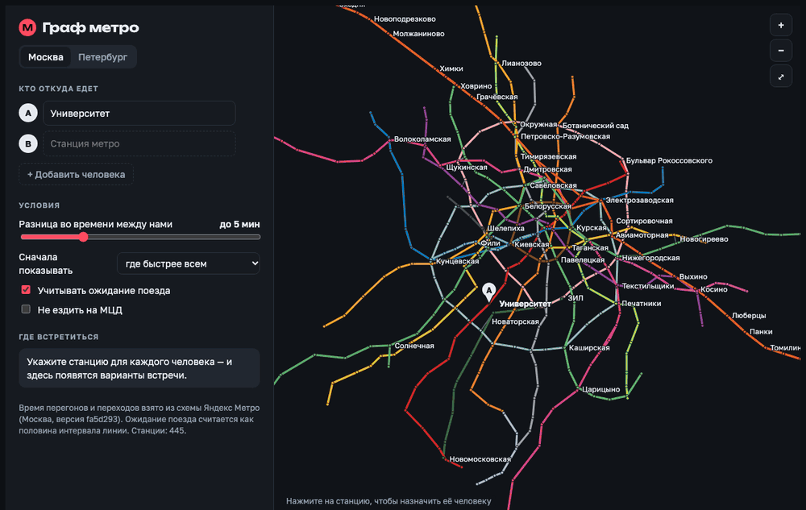
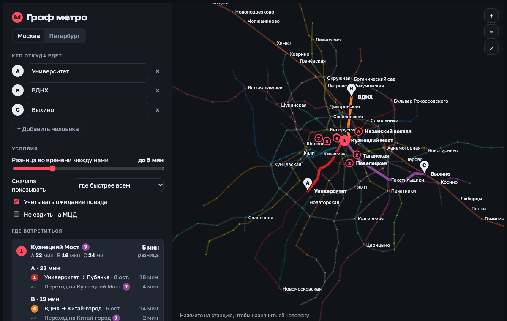
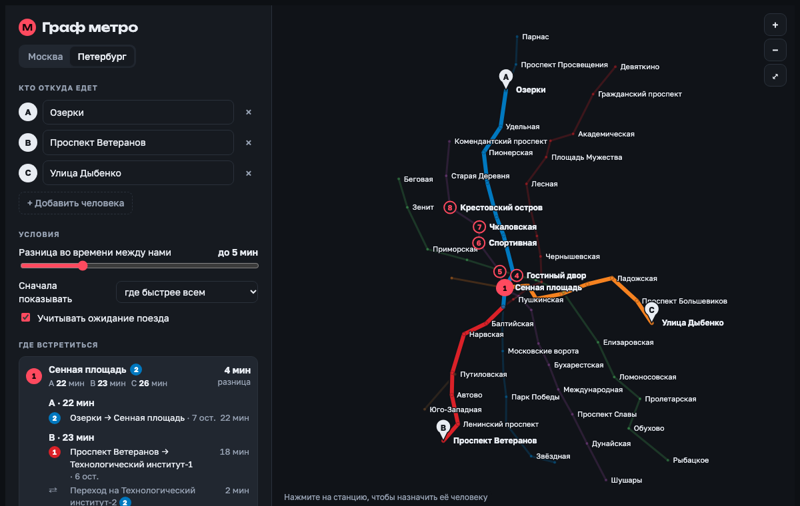
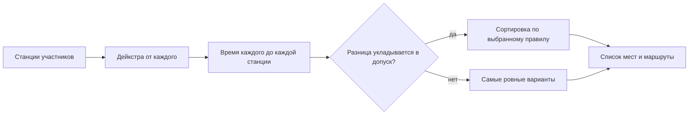

<div align="center">

# 🚇 metro-meet

**Где встретиться в метро, чтобы всем ехать одинаково**

Москва и Санкт-Петербург · от 2 до 6 человек · один HTML-файл без сервера

[](https://f7eventeen.github.io/metro-meet/)


[](LICENSE)



</div>

## Зачем

Договариваетесь встретиться с другом, и каждый раз одно и то же: «давай на Тверской» — «мне туда час ехать».
metro-meet берёт станции всех участников и находит те, до которых всем добираться примерно одинаково и при этом недолго.

## Что умеет

| | |
|---|---|
| 👥 **До шести человек** | Станцию можно вписать с автодополнением или выбрать кликом на карте |
| ⚖️ **Допустимая разница** | Ползунок от 0 до 20 минут: насколько время в пути может отличаться |
| 🧭 **Три сортировки** | Где быстрее всем, где меньше ехать в сумме, где время ровнее |
| 🗺️ **Маршрут каждого** | Линии, пересадки и минуты по каждому участку, с подсветкой на карте |
| ⏱️ **Ожидание поезда** | Учитывает интервалы линий: посадка на МЦД стоит дороже, чем на кольцо |
| 🚆 **МЦК и МЦД** | Входят в граф; МЦД можно отключить одной галочкой |
| 🌗 **Светлая и тёмная тема** | Подстраивается под систему |

<div align="center">


</div>

## Как запустить

Ничего устанавливать не нужно.

```bash
git clone https://github.com/F7EVENTEEN/metro-meet.git
open metro-meet/index.html
```

Или просто откройте [демо](https://f7eventeen.github.io/metro-meet/).

## Как это работает

Метро — это ориентированный взвешенный граф.



- **Вершины** — платформы. Станция с двумя линиями — это две вершины, соединённые переходом.
- **Рёбра** — перегоны и переходы, вес равен времени в секундах.
- **Ожидание поезда.** У каждой вершины два состояния: «стою на платформе» и «еду в поезде». Посадка после входа или пересадки стоит половину интервала линии. Так транзит через станцию без пересадки остаётся бесплатным.
- **Выбор места.** Для каждой станции считается время каждого участника, максимум, сумма и разница между самым быстрым и самым медленным. Станции с разницей больше допуска отбрасываются, остальные сортируются.

| Город | Станции | Платформы | Рёбра |
|---|---:|---:|---:|
| Москва | 445 | 492 | 1368 |
| Санкт-Петербург | 75 | 75 | 158 |

## Точность и допущения

- Время считается от платформы до платформы. Вход с улицы и выход не учитываются.
- Ожидание поезда — оценка в половину интервала, без расписания и часа пик.
- Одноимённые станции одного пересадочного узла (например, три «Киевские») объединены в одну точку старта. Погрешность — несколько минут.
- Карта географическая, по координатам станций, а не привычная схема.

## Структура

```
index.html          готовое приложение (собирается из двух файлов ниже)
src/app.html        разметка, стили и логика
data/metro.json     граф: линии, станции, платформы, рёбра
build.py            вставляет граф в приложение
```

После правок в `src/app.html` или `data/metro.json`:

```bash
python3 build.py
```

<details>
<summary><b>Формат data/metro.json</b></summary>

```jsonc
{
  "msk": {
    "name": "Москва",
    "version": "fa5d293",                       // версия схемы-источника
    "lines":    [["Сокольническая линия", "1", "#da2128", 120]],  // название, номер, цвет, интервал в секундах
    "stations": [["ЗИЛ", 37.64504, 55.69689]],                    // название, долгота, широта
    "nodes":    [[0, 19]],                                        // платформа: индекс станции, индекс линии
    "links":    [0, 1, 180, 0]                                    // плоский массив четвёрок: откуда, куда, секунды, 1 = переход
  }
}
```

</details>

## Данные

Времена перегонов, переходов и интервалы линий взяты из публичной веб-схемы [Яндекс Метро](https://yandex.ru/metro) (октябрь 2026). Проект некоммерческий, с Яндексом не связан и им не поддерживается. Если вы правообладатель и хотите, чтобы данные убрали, откройте issue.

## Планы

- [ ] Привычная схема вместо географической карты
- [ ] Время входа и выхода со станции
- [ ] Ссылка на результат, которой можно поделиться
- [ ] Другие города

## Лицензия

Код — [MIT](LICENSE). На данные из `data/metro.json` лицензия не распространяется.
